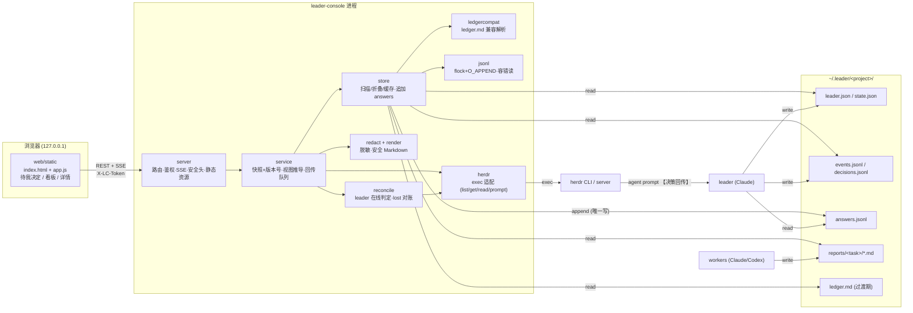
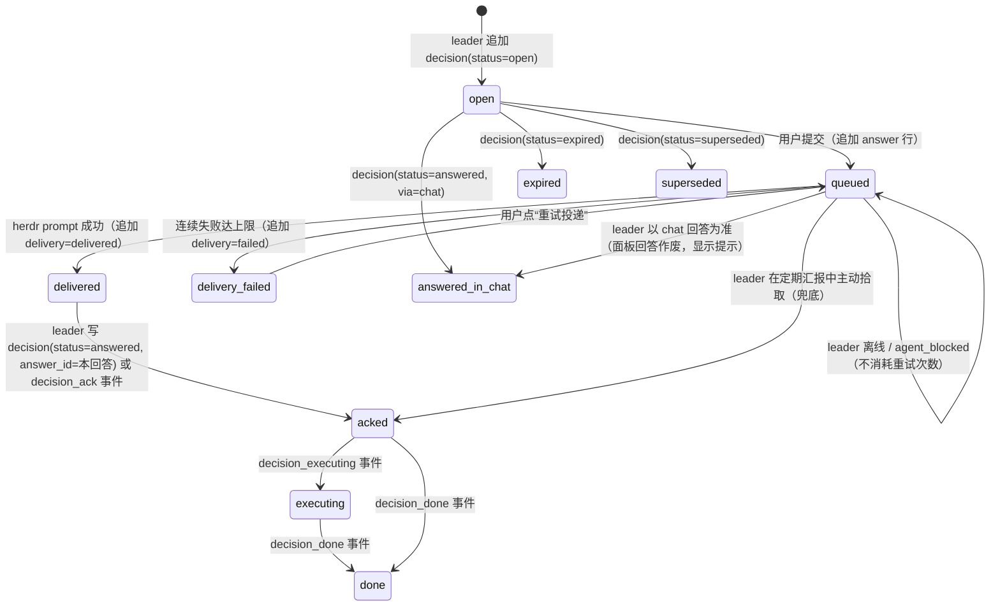

# leader-console 技术方案（v1）

> 需求：[PRD.md](PRD.md)。leader 侧改造：[leader-protocol.md](leader-protocol.md)。并行任务：[tasks.md](tasks.md)。
> 数据契约的权威定义是 `internal/model/*.go`；本文示例与 `testdata/fixtures/leader-root/demo/` 一致，由 `internal/model/contract_test.go` 严格解码校验。

## 1. 约束与原则

- **单二进制**：Go 1.24，只用标准库（`net/http` 1.22+ 路由模式、`encoding/json`、`embed`、`os/exec`、`syscall.Flock`）。`go build` 后一个文件即可运行，零第三方依赖。
- **无前端构建链**：原生 HTML + CSS + ES module，`//go:embed` 打包；实时刷新用 SSE，失败回退 5s 轮询。
- **文件即数据库**：所有状态都在 `~/.leader/*/` 的文件里，面板进程无状态，可随时重启。面板只写一种文件：`answers.jsonl`。
- **只读优先**：面板对 herdr 只用 `agent list/get/read`，唯一的写是 `agent prompt`（模板化文本，只发给已核验身份的 leader）。
- **单机单用户**：只监听回环地址；写接口 token + Host/Origin 校验。
- 平台：macOS / Linux（`flock` 依赖 unix；不支持 Windows）。

## 2. 技术选型与理由

| 维度 | 选择 | 理由 / 放弃的方案 |
|---|---|---|
| 语言 | Go 1.24 标准库 | 单二进制、并发模型适合轮询 + SSE；本机已装 1.24。 |
| 路由 | `http.ServeMux`（`GET /api/v1/tasks/{project}/{id}`） | 1.22 起支持方法与通配符，无需 chi/gin。 |
| 实时 | SSE（`text/event-stream`）只推“版本号变化”，前端再拉数据 | 比 WebSocket 简单，标准库即可；只推版本号避免 SSE 与 REST 两套数据格式。 |
| 文件变更检测 | 每 2s 对 `~/.leader/*/` 做 `stat`（size+mtime 指纹），变化才重新解析 | fsnotify 是第三方依赖；项目数 < 20、文件 < 1MB，`stat` 成本可忽略。 |
| Markdown 渲染 | 自写安全子集渲染器（标题、段落、列表、代码块、表格、链接、粗体/行内代码） | goldmark 质量更好但引入依赖；报告内容简单，子集够用。**待决策**：是否允许 goldmark 作为唯一例外（见 §12）。 |
| 前端 | 原生 ES module，`textContent` 渲染，hash 路由 | 页面只有 3 个，无需框架；无 Node。 |
| jsonl 并发 | `O_APPEND` + 单次 `write` + 旁路锁文件 `flock` | 见 §8。 |
| herdr 调用 | `os/exec` 参数数组（不经 shell），命令前缀可配置，超时 5s | 避免注入；可指向 `testdata/fake-herdr.sh` 做测试。 |

## 3. 架构

### 3.1 架构图



### 3.2 模块划分

| 包 | 职责 | 依赖 | 负责任务 |
|---|---|---|---|
| `internal/model` | 数据契约（磁盘 + 视图），只有类型 | — | 骨架（已冻结） |
| `internal/config` | flag / 环境变量；回环地址校验 | — | 骨架 |
| `internal/jsonl` | 加锁追加、容错逐行读、按 key 折叠 | — | A |
| `internal/ledgercompat` | ledger.md → `[]model.Task` + `[]model.LegacyHint` | model | A |
| `internal/store` | 扫描项目、读文件、mtime 缓存、报告 ID 映射与路径白名单、`AppendAnswer` | model, jsonl, ledgercompat | A |
| `internal/herdr` | `Client` 接口 + exec 实现 + 内存 fake | — | D |
| `internal/reconcile` | 纯函数：`ProjectData × []herdr.Agent → LeaderPresence, map[taskID]TaskLive` | model, herdr | D |
| `internal/redact` | 凭证脱敏 | — | D |
| `internal/render` | 安全 Markdown → HTML | — | D |
| `internal/service` | 后台循环（扫描 / herdr 刷新）、快照与版本号、视图推导（看板列、决策状态、排序）、回答提交与投递队列 | store, herdr, reconcile, redact, render, model（只依赖接口） | B |
| `internal/server` | HTTP 路由、token/Host/Origin 中间件、安全响应头、SSE、首页 token 注入 | service, web | B |
| `cmd/leader-console` | 组装与启动 | 全部 | B（联调时） |
| `web/` | 嵌入的静态前端 | — | C |

### 3.3 目录结构

```
leader-console/
├── cmd/leader-console/main.go
├── internal/
│   ├── model/          # 契约（冻结）+ contract_test.go
│   ├── config/
│   ├── jsonl/          # A
│   ├── ledgercompat/   # A
│   ├── store/          # A（store.go 中的接口已冻结）
│   ├── herdr/          # D（herdr.go 中的接口已冻结）
│   ├── reconcile/      # D
│   ├── redact/         # D
│   ├── render/         # D
│   ├── service/        # B
│   └── server/         # B
├── web/
│   ├── web.go          # embed
│   └── static/         # C：index.html / app.js / style.css / mock/*.json
├── testdata/
│   ├── fixtures/leader-root/{demo,legacy-demo}/   # 共享夹具（新协议 / 过渡期）
│   └── fake-herdr.sh                               # 假 herdr（格式对齐 0.9.3）
├── docs/  PRD.md design.md leader-protocol.md tasks.md
├── Makefile  README.md  go.mod
```

## 4. 数据契约

通用规则：
- 编码 UTF-8；时间一律 RFC 3339 带时区（leader 用 `date -Iseconds` 生成）。
- 读取方容忍未知字段；新增字段必须可选。`schema_version` 不认识（> 1）时该项目显示“协议版本过新”，其余项目照常。
- jsonl：一行一个紧凑 JSON 对象，`\n` 结尾。读取时跳过无法解析的行（记 warning），**忽略最后一个不以 `\n` 结尾的残行**（写入中）。
- 路径类字段（`reports`、`report_refs`）是相对项目目录的路径；过渡期允许 `/tmp/<name>.md`。
- 项目 id = `~/.leader` 下的目录名，必须匹配 `^[A-Za-z0-9][A-Za-z0-9._-]{0,127}$`；任务 id / 决策 id / 回答 id 同样字符集。

### 4.1 leader.json（leader 写，整文件原子替换）

Go：`model.LeaderInfo` / `model.LeaderAgent`。

| 字段 | 类型 | 必填 | 说明 |
|---|---|---|---|
| schema_version | int | ✔ | 1 |
| protocol_version | string | ✔ | `lc-1` |
| project | string | ✔ | = 目录名 |
| title | string | | 显示名 |
| cwd | string | ✔ | leader 工作目录；投递前与 herdr agent 的 cwd 比对 |
| leader.agent | string | ✔ | `claude` |
| leader.herdr_name | string | | leader 在 herdr 中的名字（建议协议要求 leader 启动时 `herdr agent rename` 成 `leader-<project>`） |
| leader.pane_id | string | | 无名字时用 pane 作 target |
| leader.session_id | string | | herdr `agent_session.value`，用于身份核验 |
| started_at | time | ✔ | |
| heartbeat_at | time | ✔ | 每次定期汇报、每次处理【决策回传】时刷新 |
| report_interval_min | int | | 默认 10；心跳 TTL = 2 × interval + 5 分钟 |

```json
{
  "schema_version": 1,
  "protocol_version": "lc-1",
  "project": "demo",
  "title": "用户身份 header 生效范围",
  "cwd": "/Users/me/work/dev/tasks/demo",
  "leader": {"agent": "claude", "herdr_name": "leader-demo", "pane_id": "w1:pA",
             "session_id": "e4916e66-03ee-408d-88c3-ff6c201bf695"},
  "started_at": "2026-10-21T09:00:00+08:00",
  "heartbeat_at": "2026-10-21T15:50:00+08:00",
  "report_interval_min": 10
}
```

### 4.2 state.json（leader 写，整文件原子替换）

Go：`model.State` / `model.Task` / `model.Link`。

JSON Schema（节选，完整字段见 Go 结构体）：

```json
{
  "$schema": "https://json-schema.org/draft/2020-12/schema",
  "type": "object",
  "required": ["schema_version", "project", "updated_at", "tasks"],
  "properties": {
    "schema_version": {"const": 1},
    "project": {"type": "string"},
    "updated_at": {"type": "string", "format": "date-time"},
    "tasks": {"type": "array", "items": {
      "type": "object",
      "required": ["id", "name", "kind", "goal", "status", "created_at", "updated_at"],
      "properties": {
        "id": {"type": "string", "pattern": "^[A-Za-z0-9][A-Za-z0-9._-]{0,127}$"},
        "name": {"type": "string"},
        "kind": {"enum": ["claude", "codex"]},
        "role": {"enum": ["impl", "review", "research", "ship", "merge"]},
        "parent_id": {"type": "string"},
        "agent_name": {"type": "string"}, "pane_id": {"type": "string"},
        "repo": {"type": "string"}, "branch": {"type": "string"}, "worktree": {"type": "string"},
        "goal": {"type": "string"},
        "status": {"enum": ["queued","working","blocked","needs_user","reviewing","ready_to_merge","done","failed","lost"]},
        "result_summary": {"type": "string"},
        "reports": {"type": "array", "items": {"type": "string"}},
        "links": {"type": "array", "items": {"type": "object", "required": ["type","title"],
          "properties": {"type": {"enum": ["mr","meego","dev_task","lark_doc","devx_release","commit","other"]},
                         "title": {"type": "string"}, "url": {"type": "string", "format": "uri"}}}},
        "rework_count": {"type": "integer", "minimum": 0},
        "created_at": {"type": "string", "format": "date-time"},
        "updated_at": {"type": "string", "format": "date-time"},
        "started_at": {"type": "string", "format": "date-time"},
        "notified_at": {"type": "string", "format": "date-time"}
      }}}
  }
}
```

示例（节选）：

```json
{
  "schema_version": 1, "project": "demo", "updated_at": "2026-10-21T15:55:00+08:00",
  "tasks": [{
    "id": "uih-copilot", "name": "uih-copilot", "kind": "codex", "role": "impl",
    "agent_name": "uih-copilot", "pane_id": "w1:pP",
    "repo": "copilot_marscode", "branch": "feat/user-identity-header",
    "worktree": "/Users/me/.herdr/worktrees/copilot_marscode/feat-uih",
    "goal": "copilot 侧 header 生效范围", "status": "ready_to_merge",
    "result_summary": "评审可提交；2 条补测试建议已处理；等用户授权提交和提 MR",
    "reports": ["reports/uih-copilot/report.md"],
    "links": [{"type": "mr", "title": "MR !6600", "url": "https://code.example.com/mr/6600"}],
    "rework_count": 1,
    "created_at": "2026-10-21T14:45:00+08:00", "updated_at": "2026-10-21T15:55:00+08:00",
    "started_at": "2026-10-21T14:46:00+08:00"
  }]
}
```

### 4.3 events.jsonl（leader 只追加）

Go：`model.Event`，类型枚举见 `model.EventType`（未知类型按 `other` 展示）。

| 字段 | 必填 | 说明 |
|---|---|---|
| ts | ✔ | |
| type | ✔ | task_created / dispatched / started / progress / blocked / unblocked / review_requested / review_passed / review_failed / rework / merged / done / failed / lost / report_written / notified / decision_opened / **decision_ack** / **decision_executing** / decision_done |
| actor | | leader / worker 名 / user |
| task_id, decision_id, answer_id | | 关联对象；`decision_ack/executing/done` 必须带 decision_id 和 answer_id（对话中回答时 answer_id 为空） |
| summary | ✔ | 一句话 |
| data | | 任意 JSON 对象 |

```jsonl
{"ts":"2026-10-21T14:45:00+08:00","type":"dispatched","actor":"leader","task_id":"uih-copilot","summary":"派发给 codex（w1:pP）"}
{"ts":"2026-10-21T16:00:20+08:00","type":"decision_ack","actor":"leader","task_id":"uih-fe","decision_id":"d-20261021-002","answer_id":"a-20261021-160012-7f3c","summary":"收到：B 先用 mock 开工"}
```

### 4.4 decisions.jsonl（leader 只追加，同 id 后写覆盖）

Go：`model.Decision` / `model.Option` / `model.DecisionAnswer`。

- 折叠规则：按文件顺序，同 `id` 的后一行**整条替换**前一行（不做字段合并，leader 每次写完整对象）。
- `id` 格式建议 `d-YYYYMMDD-NNN`，项目内唯一。
- `status`：`open` → `answered`（带 `answer`）/ `expired` / `superseded`（带 `superseded_by`）。终态不可回到 open；若 leader 违反，面板以最后一行为准但记 warning。
- `answer.via=panel` 时 `answer_id` 必须等于 answers.jsonl 中的回答；`via=chat` 表示用户在对话中直接答了。

```jsonl
{"id":"d-20261021-001","task_id":"uih-copilot","question":"uih-copilot 评审通过，是否授权提交并提 MR？","context":"评审结论可提交；补测试建议已处理。","options":[{"key":"A","label":"提交并提 MR","impact":"进入集成分支"},{"key":"B","label":"先不提交","impact":"任务停在待合入"}],"recommended":"A","recommend_reason":"评审已通过且无阻断","allow_free_text":true,"urgency":"normal","deadline":"2026-10-21T18:00:00+08:00","report_refs":["reports/uih-copilot/report.md"],"status":"open","created_at":"2026-10-21T15:55:00+08:00","updated_at":"2026-10-21T15:55:00+08:00"}
{"id":"d-20261021-002", "...": "...", "status":"answered","answer":{"via":"panel","answer_id":"a-20261021-160012-7f3c","summary":"B 先用 mock 开工","answered_at":"2026-10-21T16:00:12+08:00"},"updated_at":"2026-10-21T16:00:20+08:00"}
```

### 4.5 answers.jsonl（面板只追加）

Go：`model.AnswerLine`（磁盘行）、`model.Answer`（折叠后）。

两种行：
- `type=answer`：用户回答，每个 `answer_id` 只出现一次。`option` 与 `text` 至少一个非空；`option` 必须是该决策的某个 `key`；`text` ≤ 2000 字符。
- `type=delivery`：一次投递尝试的结果，`delivery ∈ {queued, retry, delivered, failed}`，`attempt` 递增。折叠时取最后一行；没有 delivery 行等价于 `queued`。

`answer_id` 格式：`a-YYYYMMDD-HHMMSS-<4 位随机 hex>`。`client_request_id` 由前端生成，用于幂等（同一 `client_request_id` 重复提交返回同一个回答）。

```jsonl
{"type":"answer","answer_id":"a-20261021-160012-7f3c","at":"2026-10-21T16:00:12+08:00","decision_id":"d-20261021-002","option":"B","text":"mock 放在 fe/mocks 下","by":"panel","client_request_id":"c-1a2b3c"}
{"type":"delivery","answer_id":"a-20261021-160012-7f3c","at":"2026-10-21T16:00:13+08:00","delivery":"delivered","attempt":1,"target":"leader-demo"}
```

### 4.6 reports/

`~/.leader/<project>/reports/<task_id>/<name>.md`。约定文件名：`report.md`、`review-<reviewer>.md`、`rework-<n>.md`、`kickoff.md`。面板按 mtime 倒序列出；报告 ID = 文件名（不含目录），只能在 `reports/<task_id>/` 内解析。

## 5. 过渡期兼容：解析 ledger.md

条件：项目目录没有 `state.json` 但有 `ledger.md` 时启用（`ProjectData.Source = "ledger.md"`）。只读、尽力而为，解析失败不影响其他项目。

算法（`ledgercompat.Parse(r io.Reader, loc *time.Location) (tasks []model.Task, hints []model.LegacyHint, warnings []string)`）：
1. 逐行扫描，找到**第一张**表头同时包含 `name` 与 `状态` 的 Markdown 表；表头下一行为分隔行（`|---|`）。遇到第一个非 `|` 开头的行即表结束——`## 备注`、`## 复盘` 等段落不会被当成任务。
2. 列按**表头名**映射（不按位置），支持别名：`name`；`kind`；`pane`；`worktree`；`目标|goal`；`状态|status`；`结果|result`；`更新时间|updated`；`已通知|notified`。缺列则字段留空。
3. 单元格切分：去掉首尾 `|`，按未转义的 `|` 切分（`\|` 视为字面量），各单元格 TrimSpace。列数与表头不符时：多则合并尾部到最后一列，少则补空，并记 warning。
4. 字段映射：
   - `id = name`；同名重复时后者加 `#2` 后缀并记 warning。
   - `kind`：小写；非 claude/codex 原样保留。
   - `pane`：用正则 `w[0-9A-Za-z]+:p[0-9A-Za-z]+` 提取 pane id（`wS:p1（已关闭）` → `wS:p1`），含“已关闭”时视为不期望存活。
   - `worktree`：以 `/` 或 `~/` 开头才填入 `Worktree`（展开 `~`），否则整段放进 `Branch` 显示（如 `feat-config-cloud-nodes`、`无（只读）`）。
   - `状态`：取第一个英文单词小写，属于已知枚举则用，否则 `working` 并记 warning。
   - `结果` → `ResultSummary`；用 `/tmp/[A-Za-z0-9._-]+\.md` 提取报告路径放入 `Reports`。
   - `更新时间`：`2006-01-02 15:04` 按本地时区解析 → `UpdatedAt`（解析失败为零值）；`CreatedAt` 无从得知，取零值。
   - `已通知`：取前 16 个字符尝试解析为 `NotifiedAt`。
5. 待合入推断：`status=done` 且结果匹配 `等(待)?用户(确认|授权)[^；;]*(提交|合入|MR)|交.{0,10}合入` → 看板列记为 `to_merge`（由 service 推导，不改 Status）。
6. LegacyHints：结果列匹配 `等(待)?用户|待用户(决定|确认)|需要用户` 且状态不是 failed/lost 的任务，生成只读提示 `{task_id, text: 结果原文}`。
7. 没有 events / decisions / answers；leader 在线判定 reason 为 `no_leader_json`。

已用真实 `~/.leader/tob-check-estimated-balance/ledger.md` 核对（2026-10-21 时 40 行任务、9 列，列名与上述一致，无转义竖线）；`testdata/fixtures/leader-root/legacy-demo/ledger.md` 是脱敏后的同构样本，含“已关闭”pane、`/tmp` 报告、备注/复盘段落等边界。

## 6. HTTP API

前缀 `/api/v1`。返回 JSON（`Content-Type: application/json; charset=utf-8`）。错误统一为 `{"error":{"code":"...","message":"..."}}`。

| 方法 | 路径 | 说明 | 返回 |
|---|---|---|---|
| GET | `/healthz` | 存活（骨架已实现） | `{"status":"ok","version","uptime_sec"}` |
| GET | `/` 及静态文件 | 前端；`index.html` 中的 `__LC_TOKEN__` 替换为本次进程 token | HTML |
| GET | `/api/v1/overview` | 首页：项目摘要 + 所有未关闭决策（已排序）+ 最近 24h 已关闭决策 + legacy 提示 + herdr 健康 | `model.Overview` |
| GET | `/api/v1/tasks?project=&column=` | 看板卡片 | `{"version","tasks":[]model.TaskView}` |
| GET | `/api/v1/tasks/{project}/{task}` | 任务详情：任务 + 事件（倒序）+ 报告列表 + 关联决策 | `model.TaskDetail` |
| GET | `/api/v1/tasks/{project}/{task}/reports/{report}` | 渲染后的报告（已脱敏） | `{"id","title","html","truncated"}` |
| GET | `/api/v1/tasks/{project}/{task}/terminal?source=recent&lines=80` | worker 终端最近输出（已去 ANSI、已脱敏）；任务无 agent 时 404 | `{"text","agent_status","fetched_at"}` |
| GET | `/api/v1/decisions?project=&state=` | 决策列表（默认未关闭） | `{"version","decisions":[]model.DecisionView}` |
| POST | `/api/v1/decisions/{project}/{decision}/answer` | 作答（写）。Body `{"option":"B","text":"...","client_request_id":"c-..."}` | 202 `model.DecisionView` |
| POST | `/api/v1/answers/{project}/{answer}/retry` | 手动重试投递（写），仅 `delivery=failed` 时允许 | 202 `model.DecisionView` |
| GET | `/api/v1/stream` | SSE。事件 `version`（data: `{"version":"..."}`）在快照变化时推送；每 15s 发注释行保活 | event-stream |

作答错误码：`400 invalid_answer`（option 不在选项内 / 都为空 / 超长）、`404 not_found`、`409 already_answered`（已有面板回答或 decision 非 open；body 附当前 DecisionView）、`409 protocol_unavailable`（项目没有 decisions.jsonl，过渡期）、`403 forbidden`（token/Origin/Host）。

写接口要求：`X-LC-Token` 等于进程 token（常量时间比较）；`Content-Type: application/json`；`Origin` 若存在必须等于 `http://<Host>`；Body ≤ 16 KiB。

视图推导（service 负责）：
- 看板列：见 PRD §8；`TaskLive.Lost` 为真的进行中任务列为 `blocked`。
- 决策排序：`state=open` 优先；`urgency` high > normal > low；`deadline` 升序（无 deadline 排后）；`created_at` 升序。
- `RunningFor`：非终态任务 = now − (StartedAt ?? CreatedAt)；终态 = 0。

## 7. 决策回传状态机

### 7.1 面板展示状态（`model.DecisionState`）

由三方数据推导：decision 最新行（leader）、answer 折叠（面板）、events（leader）。



推导优先级（自上而下取第一个命中）：
1. decision.status = superseded → `superseded`；= expired 且无面板回答 → `expired`。
2. decision.status = answered 且 via = chat → `answered_in_chat`（若面板也有回答，卡片提示“对话中已处理，面板回答未被采用”）。
3. 有面板回答：存在 `decision_done(answer_id)` → `done`；存在 `decision_executing` → `executing`；decision.answered 且 answer_id 匹配，或存在 `decision_ack` → `acked`；delivery = delivered → `delivered`；= failed → `delivery_failed`；否则 `queued`。
4. 否则 `open`（deadline 已过时 `Overdue=true`，仍可作答）。

### 7.2 提交（`POST .../answer`）

在 service 内对 `(project, decision)` 加进程内互斥锁，并在 `answers.jsonl.lock` 上持 `flock` 期间：
1. 重新加载项目（绕过缓存），校验 decision 存在且 `status=open`、无该 decision 的面板回答 → 否则 409。同 `client_request_id` 的回答已存在 → 直接返回它（幂等）。
2. 追加 `type=answer` 行（含 `at`）。
3. 释放锁，返回 202（state=queued），并把 answer_id 投入投递队列。

### 7.3 投递

- **目标解析**（reconcile 产出 `LeaderPresence`）：
  1. 无 leader.json → 离线（`no_leader_json`）。
  2. `now − heartbeat_at > 2×interval + 5min` → 离线（`heartbeat_stale`）。
  3. target = `herdr_name` 或 `pane_id`；在最近一次 `herdr agent list` 结果中按名字或 pane 找不到 → `agent_not_found`（herdr 本身调用失败 → `herdr_unavailable`）。
  4. 身份核验（reconcile 基于 list 结果判定；service 在真正 prompt 前再用 `herdr agent get <target>` 复核一次）：agent 的 `cwd` 必须等于 leader.json 的 `cwd`；若 leader.json 有 `session_id` 且 herdr 返回了 session，则两者必须相等。否则 `identity_mismatch`（**防止 herdr 重启后 pane id 复用，把决策发给别的会话**）。
- **prompt 文本**（固定模板，服务端生成，单行，去控制字符，≤ 300 字符）：
  ```
  【决策回传】project=<project> decision=<decision_id> answer=<answer_id> 选择=<option key> <option label 截断 40 字>[ 补充=<text 截断 80 字>…] 详见 ~/.leader/<project>/answers.jsonl
  ```
  leader 以 answers.jsonl 中的完整内容为准，prompt 里的摘要只为让对话可读。
- **调用**：`herdr agent prompt <target> <text>`（参数数组，超时 10s）。退出码 0 → 追加 `delivery=delivered`。
- **失败处理**：
  - leader 离线 / `agent_blocked`（leader 在等权限确认）：不追加行、不计次数，保持 `queued`，每 15s 复查。
  - 其他错误（`agent_prompt_stalled`、超时、exec 失败）：追加 `delivery=retry`（attempt+1，error），退避 5s → 15s → 30s → 60s；第 5 次失败追加 `delivery=failed`。
  - 重复投递是安全的：leader 协议要求按 `answer_id` 幂等处理。
- **重启恢复**：service 启动时扫描所有 `delivery ∈ {queued, retry}` 的回答重新入队。面板不在运行时，leader 在定期汇报中拾取未处理回答（协议兜底）。
- **ack 超时提示**：delivered 后 60s 仍未 acked，卡片显示“leader 可能正忙，已送达，等待确认”；不自动重发。

## 8. 并发与一致性

| 文件 | 写入方 | 并发模型 |
|---|---|---|
| leader.json / state.json | 仅本项目 leader | 写 `*.tmp` 后 `rename`（同目录原子替换）；读方要么看到旧版要么看到新版。 |
| events.jsonl / decisions.jsonl | 仅本项目 leader（单写者） | `>>` 追加单行（O_APPEND）。leader 是串行执行工具调用的单写者，无写写竞争。 |
| answers.jsonl | 面板（可能多个实例 / 多个 goroutine） | 进程内 `sync.Mutex` + 跨进程 `flock(answers.jsonl.lock, LOCK_EX)`；文件以 `O_WRONLY|O_APPEND|O_CREATE` 打开，**每行一次 `write` 调用**（先在内存拼好含 `\n` 的完整行），写后 `fsync`。 |
| reports/ | worker | 各任务独立目录；面板只读。 |

读侧一致性：
- **残行**：O_APPEND 在本地文件系统上对单次 `write` 是原子的，但读方仍可能在写入中途读取。读取 jsonl 时丢弃最后一个不以 `\n` 结尾的片段，下个扫描周期再读。
- **坏行**：无法解析的行跳过并记 warning（显示在项目摘要里），不中断后续行。
- **跨文件时序**：leader 先写 decisions/events 再写 state.json；面板每次扫描时一次性读取同一项目的所有文件并整体替换快照（单个指针原子替换），HTTP 读到的是某个完整快照。
- **单写者校验**：面板启动时对 `$XDG_STATE_HOME/leader-console/instance.lock`（默认 `~/.local/state/leader-console/`）加 `flock`，失败则提示“已有实例在运行”并退出——避免两个面板同时投递造成重复 prompt。answers 的 flock 是第二道防线。
- **为什么不用 flock 约束 leader**：leader 用 shell 写文件，难以可靠加锁；通过“每个文件只有一个写者”消除写写竞争，比要求 LLM 正确使用锁更可靠。若用户批准 `leader-console emit` 辅助命令（§12），leader 也可以走加锁 + 校验的写入路径。

## 9. 安全

| 威胁 | 措施 |
|---|---|
| 远程访问 | 只允许回环监听地址（`config.Validate`，骨架已实现）。 |
| DNS rebinding | 所有请求校验 `Host` ∈ {`127.0.0.1:<port>`, `localhost:<port>`, `[::1]:<port>`}，否则 403。 |
| CSRF | 写接口要求 `X-LC-Token`（32 字节 `crypto/rand`，hex）；自定义头会触发 CORS 预检，而面板不返回任何 CORS 头；再校验 `Origin`。token 仅存在内存，通过首页 `<meta name="lc-token">` 注入（跨源页面无法读取同源 HTML）。 |
| XSS | 前端只用 `textContent` / `createElement`；唯一的 `innerHTML` 是服务端 render 产出的 HTML（先整体转义再生成白名单标签，链接仅 http/https，加 `rel="noopener noreferrer"`）。响应头 `Content-Security-Policy: default-src 'self'; script-src 'self'; style-src 'self'; img-src 'self' data:; connect-src 'self'; frame-ancestors 'none'; base-uri 'none'`，`X-Content-Type-Options: nosniff`，`Referrer-Policy: no-referrer`。 |
| 凭证泄露 | redact 对报告、终端输出、结果摘要、决策背景、事件摘要脱敏：`AKIA/AKLT…` 类 AK、`sk-`/`ghp_`/`glpat-`/`xox[bp]-` 类 token、JWT（`eyJ…\.eyJ…\.…`）、PEM 私钥块、`Bearer <x>`、`(password|passwd|secret|token|api[_-]?key|access[_-]?key|auth[_-]?key|secret[_-]?key)\s*[:=]\s*<值>` 的值部分；保留前 4 位 + `****`。 |
| 路径穿越 | project/task/report 参数先匹配 id 正则；报告只从 `reports/<task>/` 读（`filepath.Rel` 校验仍在目录内，`Lstat` 拒绝符号链接）；过渡期 `/tmp` 报告只允许 `^/tmp/[A-Za-z0-9._-]+\.md$` **且**被该项目 ledger 结果列引用；读取上限 1 MiB。 |
| 命令执行 | 只执行配置的 herdr 命令前缀 + 固定子命令；参数数组不经 shell；prompt 文本模板化、去控制字符；target 来自 leader.json 且经身份核验。不暴露任何“执行命令”接口。 |
| 资源滥用 | `ReadHeaderTimeout`、Body 上限、terminal `lines` ≤ 400、SSE 连接数 ≤ 16。 |

## 10. 刷新与性能

- service 后台两个 ticker：扫描（2s，按 stat 指纹只重解析变化的项目）、herdr list（5s，失败时 `HerdrHealth.ok=false`，看板仍可用，live 字段为空）。
- 快照版本 = 各项目 Version + herdr 列表哈希的哈希。版本变化 → SSE 广播 `version`。
- 前端：收到 `version` 后重新拉当前页面接口；SSE 断开时每 5s 轮询 `/api/v1/overview` 的 version。
- 终端输出按需拉取（详情页打开时 + 手动刷新，最多 5s 一次），不进快照。

## 11. 测试策略

| 层 | 方法 | 覆盖重点 |
|---|---|---|
| model | `contract_test.go` 严格解码 `testdata/fixtures`（已实现） | 文档示例 ↔ 结构体不漂移 |
| jsonl | 单元 + 子进程并发测试（`os/exec` 重新执行测试二进制，N 进程 × M 行并发追加） | 无交错、无丢行；残行忽略；坏行跳过 |
| ledgercompat | 表驱动 + golden（`testdata/*.md` → `*.golden.json`） | 列名映射、转义竖线、列数不符、pane 提取、备注/复盘不误判、时间解析 |
| store | `t.TempDir()` 构造项目目录 | state.json 优先、ledger 回退、缓存命中、路径白名单、符号链接拒绝、AppendAnswer 并发 |
| herdr | exec 实现指向 `testdata/fake-herdr.sh`（`FAKE_HERDR_FAIL`、`FAKE_HERDR_LOG`）；另提供内存 `herdr.Fake` 给其他包 | JSON 解析、错误码映射、超时、参数不经 shell |
| reconcile / redact / render | 纯函数表驱动 | 心跳 TTL 边界、身份核验、lost 判定；脱敏样本集（含误报样本）；XSS 向量（`<script>`、`javascript:` 链接、属性注入） |
| service | 内存 fake store + `herdr.Fake` + 可注入时钟 | 状态机每条边；幂等；409；离线排队；退避；重启恢复 |
| server | `httptest` | 路由、token/Host/Origin 403、Body 上限、SSE 首帧、CSP 头 |
| 前端 | 无 Node：`make run-fixture` 手工走查清单 + `web` 包的 Go 测试检查静态文件存在、`__LC_TOKEN__` 占位存在、无外链脚本 | |
| 端到端 | `make run-fixture` + curl 脚本：作答 → 检查 answers.jsonl 与 `FAKE_HERDR_LOG` | 全链路 |

门禁：`make check`（gofmt + vet + `go test -race` + build）。测试不得读真实 `~/.leader`、不得调用真实 herdr。

## 12. 风险与待决策

1. **leader 协议改造需要用户审批**（改全局 `~/.claude/agents/leader.md`，影响所有 leader 会话）。未批准前面板只能只读展示 ledger.md，决策作答不可用。
2. **leader 写 JSON 的可靠性**：LLM 手写 JSON 容易出错。可选方案：面板二进制提供 `leader-console emit {heartbeat|task|event|decision}` 子命令（校验 + 加锁 + 原子写），leader 调用它而不是手写。建议在 MVP 之后立即做（不阻塞并行开发）。
3. **leader 没有 herdr 名字**（实测当前 leader agent 无 `name`）：协议要求 leader 启动时 `herdr agent rename <self> leader-<project>`。否则只能用 pane_id，并依赖 cwd/session 核验。
4. **Markdown 渲染**：标准库子集 vs goldmark（唯一第三方依赖）。
5. **herdr prompt 成功输出未实测**（本任务禁止发送 prompt）：适配层只依赖退出码；D 任务需在用户许可下对一个测试 agent 实测一次。
6. **端口**：默认 `127.0.0.1:7788`，是否需要 launchd 常驻（二期）。
